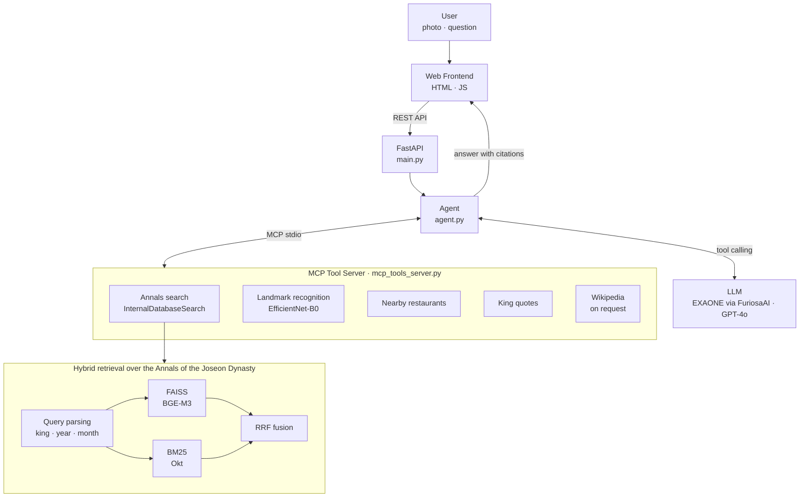

# WelKome-AI-Agent
> Take a photo of a heritage site and get its history explained, grounded in the Annals of the Joseon Dynasty (조선왕조실록).

## Achievements

- 🏆 NRF President's Award (2nd Place), WE-Meet 2025 (Ministry of Education & NRF), Feb. 2026 — [The Elec](https://www.thelec.kr/news/articleView.html?idxno=58338)
- 🎤 Live demo at FuriosaAI RENEGADE 2026 Summit, showcased as a Seoul National University team project — [FuriosaAI Blog](https://furiosa.ai/blog/renegade-2026-summit)
- Team: "조선GPT" (Chung-Ang University), developed in the SNU-led WE-Meet 2025 program with FuriosaAI (Team Leader: Seungyun Choi)

## Demo

<p align="center">
  
</p>

## Features

- **Photo-based landmark recognition**: EfficientNet-B0 identifies a heritage site from a user's photo
- **Hybrid retrieval over the Annals**: query parsing (king · year · month) → FAISS (BGE-M3) + Okt-tokenized BM25 → Reciprocal Rank Fusion
- **MCP tool server (stdio)** with tools for annals search, landmark recognition, nearby restaurants, king quotes, and Wikipedia lookup (only when the user explicitly asks for a web search)
- **LLM agent with tool calling** over an OpenAI-compatible API: EXAONE 4.0 32B (FP8) served through a FuriosaAI endpoint, or GPT-4o
- **Source-grounded answers**: the agent must search the Annals before answering and cites the retrieved records by king, reign year, Gregorian year, and month (e.g. 『조선왕조실록』 세종 4년 (1422) 11월)

## System Architecture



| Query type | Search strategy | Example |
|----------|------|------|
| Year/king/month + keyword | Keyword match within filtered chunks + FAISS, fused with RRF | "세종대왕 건강" |
| Year/king/month only | Full scan of chunks matching the filter | "1452년에 무슨 일이" |
| Concept / proper noun | FAISS MMR + BM25, fused with RRF | "경복궁 역사" |

## Tech Stack

| Area | Libraries |
|------|-----------|
| Backend | FastAPI, Uvicorn, Pydantic, python-dotenv |
| Agent | OpenAI Python SDK (OpenAI-compatible API), MCP (FastMCP, stdio) |
| Retrieval | LangChain Community (FAISS vector store, HuggingFace embeddings), sentence-transformers (`BAAI/bge-m3`), faiss-cpu, rank-bm25, KoNLPy (Okt) |
| Vision | PyTorch, torchvision (EfficientNet-B0), Pillow |
| External lookup | Wikipedia (LangChain `WikipediaQueryRun`) |
| Frontend | HTML, CSS, JavaScript, Twemoji |

## How to Run

### Requirements

| Item | Recommended |
|------|------|
| Python | 3.11 |
| RAM | 16GB or more |
| Disk | 10GB or more (including the BGE-M3 model cache) |
| Java | For the KoNLPy Okt tokenizer (falls back to a regex tokenizer if missing) |

```bash
# macOS
brew install openjdk
# Ubuntu
sudo apt-get install -y default-jdk
```

### Installation

```bash
git clone https://github.com/SeungYunChoi0/welKome-ai-agent.git
cd welKome-ai-agent
python -m venv demo_env
source demo_env/bin/activate        # Windows: demo_env\Scripts\activate
pip install -r requirements.txt
```

### Assets

The following files are not included in the repository and are not publicly distributed.

```
app/assets/
├── rag_faiss_index/
│   ├── index.faiss
│   └── index.pkl
├── bm25_index.pkl
├── landmark_classifier_best.pt
├── class_labels.json
├── restaurants.json
└── king_mbti.json

frontend/static/images/*_menu.*     # Restaurant menu photos
```

> The Annals data used to build the indexes is not redistributed in this repository. The MIT License applies to the source code only.

On first run, the BGE-M3 embedding model (`BAAI/bge-m3`) and EfficientNet-B0 weights are downloaded from the internet.

### Environment Variables

Create `app/.env`:

```env
# "openai" or "furiosa"
LLM_PROVIDER=openai

OPENAI_API_KEY=your_key_here
OPENAI_MODEL_NAME=gpt-4o

FURIOSA_API_BASE=your_endpoint_here
FURIOSA_API_KEY=your_key_here
FURIOSA_MODEL_NAME=your_model_name_here
```

### Run

```bash
python -m app.main
```

Open `http://127.0.0.1:8000` in a browser.

To accept external connections on a server:

```bash
uvicorn app.main:app --host 0.0.0.0 --port 8000
```

### API

| Method | Path | Description |
|--------|------|------|
| `GET` | `/` | Main page |
| `POST` | `/predict_image` | Heritage site photo → CV recognition + Annals summary |
| `GET` | `/restaurants/{landmark_name}` | Restaurants near the site |
| `POST` | `/chat` | Chatbot conversation |
| `GET` | `/loading_quote` | Random king quote for the loading screen |

```bash
curl -X POST http://127.0.0.1:8000/chat \
  -H "Content-Type: application/json" \
  -d '{"input": "세종대왕의 건강이 어떠했어?", "chat_history": []}'
```

## Project Structure

```
welKome-ai-agent/
├── app/
│   ├── main.py                  # FastAPI entry point
│   ├── .env                     # Environment variables (create manually, not in the repo)
│   ├── core/
│   │   ├── agent.py             # LLM + MCP agent
│   │   └── mcp_tools_server.py  # MCP tool server (RAG, CV, restaurants, quotes)
│   └── assets/                  # Models, indexes, data (not in the repo, distributed separately)
├── frontend/
│   ├── index.html
│   └── static/
├── docs/
│   └── demo.gif
├── LICENSE
└── requirements.txt
```

## Troubleshooting

- **`Failed to parse JSONRPC message from server`**: Printing to stdout in `mcp_tools_server.py` breaks MCP communication. Use `file=sys.stderr` for every `print()`.
- **`FAISS 로드 실패`** (FAISS load failed): Check that `index.faiss` and `index.pkl` exist in `app/assets/rag_faiss_index/`.
- **`Unable to locate a Java Runtime`**: Restart the terminal after installing Java. The server still runs without Java.

## License

This project's source code is licensed under the [MIT License](LICENSE). Data, model weights, and indexes are not included and are not covered by this license.
